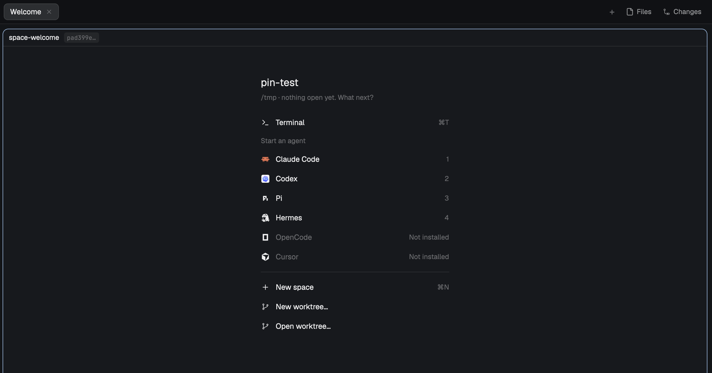

# Space Welcome

A welcome page for a [Herdr](https://herdr.dev) space that has no open tabs. When you close the last tab of a space, the space stays open and shows this page. The mod works alone and needs no other mod.



## What it does

- The page shows the name and the folder of the space.
- Click a row to open a terminal, start an installed agent, make a new space, or make a worktree.
- Press 1 to 9 to start the installed agent with that number.
- A space does not close when you close its last tab. It shows the welcome page instead.
- When the space has two tabs again, the page closes.

## Install

1. Copy `mods/space-welcome/` to `~/.config/herdr-app/mods/`.
2. Add the guard to your layout (see below).
3. Run `herdr-app check ~/.config/herdr-app/mods/space-welcome`.

The mod does not run programs, does not read files, and does not connect to the network.

## How the page opens

Herdr has no event for "a tab is closing", so the mod acts ahead with a guard: one copy of the mod in your layout that draws nothing.

- When a space is left with one tab, the guard adds a Welcome tab next to it, in the background. When you close that last tab, the space stays and shows the welcome page.
- When the space has two tabs again, the guard closes the Welcome tab.
- So a space with one tab always shows a second tab, "Welcome".

Add the guard to the root node of your layout file (`~/.config/herdr-app/layouts/<name>.json`). Herdr's shipped layouts are read-only, so clone one first (`herdr-app do layout.clone '{"name":"main","as":"my-layout"}'`).

```json
"floating": [ { "id": "welcome-guard", "content": { "mod": "space-welcome", "props": { "guard": true } }, "edge": "bottom", "align": "end" } ]
```

If the root already has `floating`, add the item to that list. The mod works by itself; no other mod needs to know about it.

You can also open the page by hand:

```sh
herdr-app do tab.new '{"space":"<id>","name":"Welcome","mod":"space-welcome","props":{"space":"<id>"}}'
```

## Build it yourself

[RECIPE.md](RECIPE.md) describes the mod in full. An agent can build the mod from the recipe in an empty folder.
