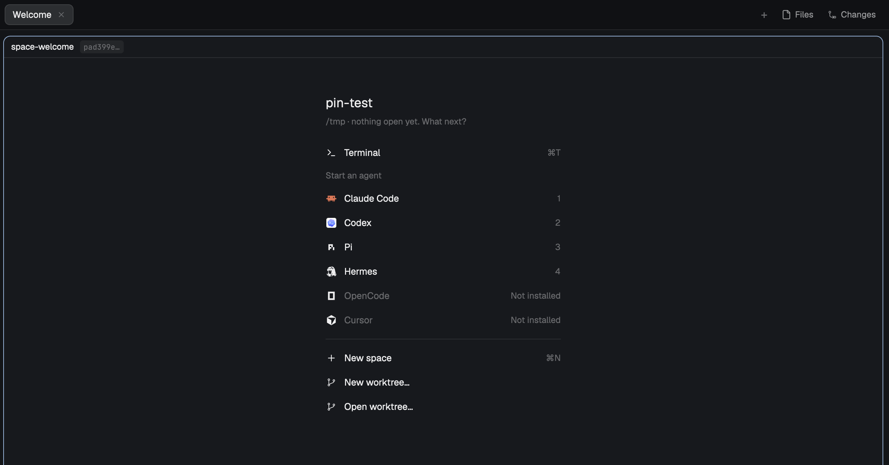

# Space Welcome

A welcome page for a space with nothing open. Instead of closing the space with its last tab, you get a
calm page in a tab named "Welcome": the space's name, its folder and "nothing open yet. What next?",
then one-click rows to open a terminal, start any installed agent (keys 1–9), make a new space or a
worktree. A guard copy of the mod in the layout keeps one Welcome tab ready next to a space's only
tab, and closes it once the space has two tabs again.

## What you see

The whole pane, `background` color, content centered horizontally in a 380px column, 48px from the
top, scrolling if short of room. Text 13px.

- **Title**: the space's name, 18px semibold, `foreground`, truncated.
- **Subtitle**: `<folder> · nothing open yet. What next?` (or just the sentence without a folder),
  12px `dim`, 16px below.
- **Rows**, each 32px tall, radius 6, padding 0 10px, gap 10px: a 16px icon cell, the label, and a
  12px `dim` hint on the right. Hover `hover`; disabled rows `dim` and not clickable.
  1. **Terminal** (`icons/shell.svg`), hint: the global `tab.new` key (`⌘T` on macOS, `Ctrl+T` elsewhere).
  2. Label **Start an agent** (28px, 12px medium `dim`).
  3. One row per installed agent, with its icon and name, hint `1`…`9`; then up to two agents that
     aren't installed, disabled, hint "Not installed". While loading: "Checking installed agents…";
     on failure: "Couldn't load agents".
  4. A 1px `border` line.
  5. **New space** (plus icon), hint: the `space.new` key. **New worktree…** and **Open worktree…**
     (branch icon).

## How it behaves

- Clicking Terminal: `tab.new {space, folder}` in the space's folder. An agent row or its number key
  (no modifiers): `tab.new {name, space, argv: agent.run}`. New space: `space.new`. Worktree rows open
  Herdr's shipped `worktree` mod as a dialog (460×280 with `action: "new"`, 560×480 with
  `action: "open"`, props `{space, folder}`).
- The page takes the keyboard when it opens (`focusable`).
- **Guard** (`props.guard: true`, one copy as a floating block in the layout, draws an empty `div()`):
  on every render and every 1s (`cx.timer.every`), for each space it counts Welcome tabs (tabs with a
  pane whose `mod` is `space-welcome`, from `panes()`) and real tabs (the rest).
  - 1 real tab and no Welcome → `tab.new {space, name: "Welcome", mod: "space-welcome", props: {space}, focus: false}`.
  - ≥2 real tabs → `tab.close {id, confirmed: true}` on each Welcome tab.
  - More than one Welcome → close all but the first.
  - Each action is remembered per space/tab id for 3s, so repeated passes don't repeat it, and a lost
    command is retried after that.
- Closing the last real tab therefore leaves the space on its Welcome tab. Closing the Welcome tab by
  hand while it's the only tab is Herdr's own close, which asks before the space goes.
- Agent statuses aren't shown here; the page only starts things.

## Built from

- One mod, `mods/space-welcome/`: `main.js`, `mod.json`
  `{ "place": "none", "title": "Welcome", "focusable": true }`, and `plus.svg`, `branch.svg` (lucide).
- Two roles by `props`: the page (`{space}`), a tab whose only pane is the mod; and the guard
  (`{guard: true}`), in the layout root's `floating`:
  `{ "id": "welcome-guard", "content": { "mod": "space-welcome", "props": { "guard": true } }, "edge": "bottom", "align": "end" }`.
  Without the guard, nothing opens the page; `herdr-app do tab.new` with the page props still works.
- `herdr` used: `theme`, `knownAgents({on: space.machine})`, `run`, `openOverlay`, `props`, `window`,
  `keys`, `checking`, `spaces`, `panes`. Commands: `tab.new`, `tab.close`, `space.new`.
- Shipped things it uses: `icons/shell.svg`, the `worktree` mod.
- Nothing reaches the network, runs programs or reads files.

## Watch out

- Herdr has no "tab closing" event, so the guard must act before the close: that's why the Welcome
  tab sits next to a lone tab all the time.
- A `tab.new` sent right after `space.new` can be lost and causes no new render: the 1s timer is what
  retries it.
- A tab created with `focus: false` doesn't start its mod copy until shown, so all opening and closing
  lives in the guard, not in the page.
- The page must not take focus in the guard role (`init` returns early).
- `props.space` is required; without it the page shows "This space" and its worktree rows are disabled.
- The guard finds Welcome tabs through `panes()` (`p.mod === "space-welcome"`), so a renamed copy of
  the mod must change that name too.
- Skip the guard's commands under `checking()`.
- Agent keys are 1–9 only, counted over installed agents.

## Done when

- `herdr-app check ~/.config/herdr-app/mods/space-welcome` passes.
- `herdr-app do tab.new '{"space":"<id>","name":"Welcome","mod":"space-welcome","props":{"space":"<id>"}}'`
  shows the page with the space's name, folder and installed agents numbered from 1.
- With the guard in the layout: a new space (one tab) gets one Welcome tab within a second or two.
- Open a second tab → Welcome goes; close it → Welcome comes back.
- Close the space's last real tab → the space stays, showing Welcome.
